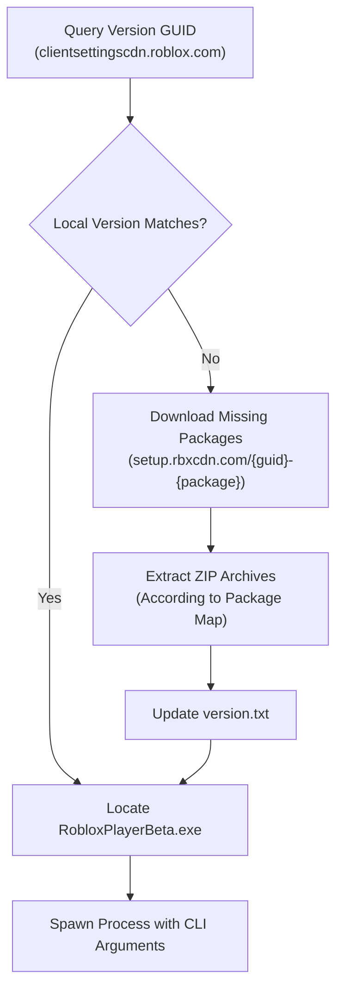

# OpenInstaller

A clean-room, open-source native C++ recreation of the official client installer (`RobloxPlayerInstaller.exe`).

---

## Technical Overview

The original `RobloxPlayerInstaller.exe` binary is a 64-bit Windows PE GUI application containing approximately 10 MB of compiled machine code (`.text` section) that communicates with content distribution endpoints to download and bootstrap client files.

This project recreates the exact installation pipeline in modular C++17 without proprietary dependencies.



---

## Extracted Package Extraction Map

The exact 22 archive packages and their target subdirectories extracted from `RobloxPlayerInstaller.exe`:

| Package Name | Relative Target Directory |
| --- | --- |
| `RobloxApp.zip` | Root (`.`) |
| `content-avatar.zip` | `content/avatar/` |
| `content-configs.zip` | `content/configs/` |
| `content-fonts.zip` | `content/fonts/` |
| `content-sky.zip` | `content/sky/` |
| `content-sounds.zip` | `content/sounds/` |
| `content-textures2.zip` | `content/textures/` |
| `content-models.zip` | `content/models/` |
| `content-textures3.zip` | `PlatformContent/pc/textures/` |
| `content-terrain.zip` | `PlatformContent/pc/terrain/` |
| `content-platform-fonts.zip` | `PlatformContent/pc/fonts/` |
| `content-platform-dictionaries.zip` | `PlatformContent/pc/shared_compression_dictionaries/` |
| `extracontent-luapackages.zip` | `ExtraContent/LuaPackages/` |
| `extracontent-translations.zip` | `ExtraContent/translations/` |
| `extracontent-models.zip` | `ExtraContent/models/` |
| `extracontent-textures.zip` | `ExtraContent/textures/` |
| `extracontent-places.zip` | `ExtraContent/places/` |
| `shaders.zip` | `shaders/` |
| `ssl.zip` | `ssl/` |
| `redist.zip` | Root (`.`) |
| `WebView2.zip` | Root (`.`) |
| `WebView2RuntimeInstaller.zip` | `WebView2RuntimeInstaller/` |

---

## Building

### Requirements

* C++17 compatible compiler (`g++`, `clang++`, or `MSVC`)
* `CMake` (3.16+)
* `libcurl`
* `libzip`

### Linux Build

```bash
cd /home/pent/Desktop/open-installer
mkdir build && cd build
cmake ..
make -j$(nproc)

```

### Windows Build (Visual Studio / CMake)

```cmd
mkdir build
cd build
cmake .. -G "Visual Studio 17 2022" -A x64
cmake --build . --config Release

```

---

## Usage

```bash
# Check version, install if needed, and run client
./build/installer

# Specify custom installation folder
./build/installer --dir ./local_install

# Force re-installation
./build/installer --force

# Pass arguments directly to the client
./build/installer -- --app -t <token>

```
